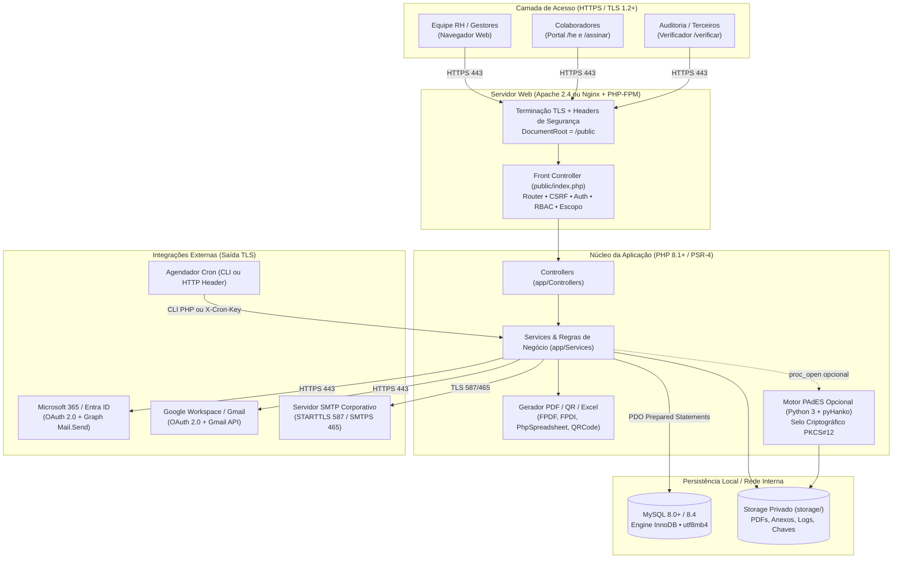

# Documentação Técnica de Arquitetura, Segurança e Implantação

**Plataforma:** Corredor Norte RH (Arcadis RH Operacional)  
**Destinatários:** Equipe de TI — Infraestrutura, Segurança da Informação (InfoSec), Banco de Dados (DBA), Redes/Firewall e Operações  
**Objetivo:** Subsidiar a avaliação técnica, homologação de segurança e implantação em ambiente corporativo.

---

## Sumário

1. [Visão Geral e Escopo Funcional](#1-visão-geral-e-escopo-funcional)
2. [Arquitetura da Solução](#2-arquitetura-da-solução)
3. [Stack Tecnológica e Dependências](#3-stack-tecnológica-e-dependências)
4. [Requisitos de Infraestrutura e Dimensionamento](#4-requisitos-de-infraestrutura-e-dimensionamento)
5. [Segurança da Informação (InfoSec) e LGPD](#5-segurança-da-informação-infosec-e-lgpd)
6. [Assinatura Eletrônica, Selo PAdES e Validade Jurídica](#6-assinatura-eletrônica-selo-pades-e-validade-jurídica)
7. [Rede, Firewall e Integrações Externas](#7-rede-firewall-e-integrações-externas)
8. [Arquitetura de Banco de Dados](#8-arquitetura-de-banco-de-dados)
9. [Configuração e Variáveis de Ambiente](#9-configuração-e-variáveis-de-ambiente)
10. [Guia de Implantação (Deploy)](#10-guia-de-implantação-deploy)
11. [Rotinas Agendadas (Cron Jobs)](#11-rotinas-agendadas-cron-jobs)
12. [Operação, Monitoramento, Backup e Continuidade](#12-operação-monitoramento-backup-e-continuidade)
13. [Checklist de Aprovação e Go-Live (Reunião com TI)](#13-checklist-de-aprovação-e-go-live-reunião-com-ti)

---

## 1. Visão Geral e Escopo Funcional

A plataforma **Corredor Norte RH** é uma aplicação web corporativa desenvolvida para centralizar, automatizar e auditar a operação de Recursos Humanos, Medição de Contratos e Controle de Equipamentos de TI.

### 1.1 Módulos Principais

| Módulo | Rotas Base | Principais Funcionalidades |
|---|---|---|
| **Visão Geral & Alertas** | `/`, `/rh/alertas`, `/ui/mapa-sistema` | Dashboards gerenciais, central de alertas com SLA, digest diário por e-mail e mapa de navegação. |
| **Efetivo & Organização** | `/rh/efetivo`, `/rh/colaboradores`, `/rh/empresas`, `/rh/contratos`, `/rh/lotacoes`, etc. | Cadastro completo de colaboradores, histórico de lotações/transferências, empresas, contratos, centros de custo, OS, localidades, cargos, funções, gestores e supervisores. |
| **Horários & Calendários** | `/rh/horarios`, `/rh/calendarios` | Gestão de horários semanais/cíclicos (padrão RHiD), escalas e feriados nacionais/municipais por localidade. |
| **Importação em Massa** | `/rh/importacoes` | Upload de planilhas Excel (`.xlsx`), validação prévia linha a linha com relatório de erros e efetivação transacional. |
| **Gestão de Ponto & CLT** | `/rh/ponto`, `/rh/ponto/justificativa-tipos` | Geração de espelhos por período, apontamento, anexos de justificativas/autorizações de HE/turno, motor de conformidade trabalhista (CLT / Portaria MTP 671/2021) com registro auditado de exceções. |
| **Medição & Lotes** | `/rh/medicao` | Fechamento de medição, dossiê consolidado e ações em lote (preencher previstos, conferir, fechar, gerar PDFs, gerar links e disparar e-mails). |
| **Folha de Ponto & Assinatura** | `/rh/folha`, `/assinar/{token}`, `/verificar/{codigo}` | Emissão de cartão de ponto em PDF, envio individual/em lote, portal de assinatura eletrônica do colaborador, registro de divergências e verificador público por hash SHA-256 e QR Code. |
| **Portal do Colaborador** | `/he/login`, `/he/relatorios`, `/he/folhas` | Portal dedicado autenticado via CPF + OTP (e-mail) para preenchimento/assinatura de Relatórios de Atividades (RA) e consulta/assinatura de Folhas de Ponto. |
| **Relatórios de Atividades & HE** | `/rh/relatorios-atividades`, `/rh/relatorio-he` | Aprovação/reabertura de RAs, exportação PDF/Excel, controle de horas extras e saldos pendentes. |
| **Vale Refeição (VR)** | `/rh/vale-refeicao` | Parametrização de regras por contrato, cálculo baseado em dias úteis/ocorrências e exportação em PDF, Excel e CSV. |
| **Entrega de Equipamentos (TI)** | `/rh/entregas-equipamentos` | Catálogo de equipamentos e periféricos, emissão de Termo de Responsabilidade em PDF, anexo de termo assinado e controle de devoluções. |
| **Governança & Sistema** | `/rh/usuarios`, `/rh/perfis`, `/rh/atividade`, `/rh/email` | Gestão de usuários, RBAC 360° granular, isolamento por contrato, monitoramento de sessões ativas/histórico de acessos e integração de e-mail corporativo (M365/Gmail/SMTP). |

---

## 2. Arquitetura da Solução

A plataforma utiliza uma arquitetura **monolítica modular MVC em PHP puro** (sem dependências de frameworks pesados de terceiros), priorizando previsibilidade operacional, baixo consumo de recursos, facilidade de auditoria de código e alta compatibilidade com ambientes Linux corporativos (on-premises, VM ou nuvem).

### 2.1 Diagrama de Arquitetura



### 2.2 Estrutura de Diretórios e Isolamento

Apenas o diretório `public/` deve ser exposto pelo servidor web (`DocumentRoot`). Todos os demais diretórios permanecem inacessíveis via HTTP.

| Diretório / Arquivo | Exposição Web | Finalidade |
|---|---|---|
| `public/` | **Público (`DocumentRoot`)** | Front controller (`index.php`), assets estáticos (`assets/css`, `assets/js`, `assets/img`, `assets/vendor`), instalador inicial (`install/`). |
| `app/` | Bloqueado | Código-fonte PHP (namespace `App\`: `Config`, `Controllers`, `Helpers`, `Install`, `Services`, `Views`, `Fonts`). |
| `config/` | Bloqueado | Configurações base (`app.php`, `database.php`, `email_oauth.php`) e overrides locais de produção (`app.local.php`, `database.local.php`). |
| `database/` | Bloqueado | Schemas SQL (`schema_*.sql`) e seeds iniciais (`seeds.sql`). |
| `storage/` | Bloqueado | Arquivos persistentes em runtime: `assinaturas/`, `uploads/`, `exports/`, `logs/`, `templates/`, `tmp/`, além dos arquivos de controle `install.lock`, `app.key` e `cron.secret`. |
| `scripts/` | Bloqueado | Scripts CLI de migração, instalação, rotinas cron, smoke tests e scripts Python de selo PAdES. |
| `vendor/` | Bloqueado | Dependências PHP gerenciadas via Composer. |

> [!IMPORTANT]
> **Defesa em profundidade:** Mesmo que o servidor web seja configurado incorretamente com `DocumentRoot` na raiz do projeto, os arquivos `.htaccess` na raiz e em `public/` bloqueiam explicitamente o acesso HTTP a `storage`, `config`, `vendor`, `app`, `database`, `scripts`, `tmp`, `output`, `.env`, `composer.json`, `composer.lock` e `docker-compose.yml` com HTTP `403 Forbidden`. Em Nginx, regras equivalentes constam na [Seção 10](#10-guia-de-implantação-deploy).

---

## 3. Stack Tecnológica e Dependências

### 3.1 Backend (PHP)

- **Versão:** PHP `>= 8.1` (recomendado **PHP 8.2** ou **8.3** LTS; compatível com PHP 8.4+).
- **Timezone padrão da aplicação e sessão MySQL:** `America/Sao_Paulo` (`UTC-03:00`).
- **Encoding padrão:** `UTF-8` (`mb_internal_encoding('UTF-8')`) e `utf8mb4_unicode_ci` no banco.

#### Extensões PHP Obrigatórias

| Extensão | Uso na Plataforma |
|---|---|
| `pdo`, `pdo_mysql` | Comunicação segura com MySQL via prepared statements nativos. |
| `openssl` | Criptografia AES-256-GCM de credenciais OAuth/SMTP e conexões TLS. |
| `curl` | Integração HTTP com Microsoft Graph API e Google OAuth/Gmail API. |
| `fileinfo` | Detecção real de MIME Type em uploads (`UploadGuard`). |
| `mbstring`, `iconv`, `intl` | Manipulação de strings UTF-8, normalização e formatação numérica/locale. |
| `zip`, `xml`, `xmlreader`, `xmlwriter`, `simplexml`, `dom`, `libxml` | Leitura e geração de planilhas Excel (`.xlsx`) via PhpSpreadsheet. |
| `gd`, `zlib`, `ctype`, `json` | Manipulação de imagens (PDF/avatares), compressão, geração de QR Codes e payloads JSON. |

#### Bibliotecas PHP (`composer.json`)

| Pacote | Versão | Finalidade |
|---|---|---|
| `phpoffice/phpspreadsheet` | `^2.0` | Importação de efetivo e exportação de relatórios Excel (`.xlsx`). |
| `setasign/fpdf` | `1.8.6` | Geração nativa de documentos PDF (Folhas de Ponto, RAs, VR, Termos de TI). |
| `setasign/fpdi` | `^2.6.10` | Leitura e composição de páginas PDF para aplicação da via assinada. |
| `chillerlan/php-qrcode` | `^5.0.5` | Geração de QR Codes de validação embutidos nos documentos. |

### 3.2 Frontend

- **Arquitetura:** Server-Side Rendering (SSR) em PHP puro + JavaScript Vanilla (ES6+), sem necessidade de build pipeline Node.js em produção.
- **Bibliotecas JS vendored localmente em `public/assets/`** (zero dependência de CDN externa para execução de scripts):
  - `pdf.js` (`public/assets/vendor/pdfjs/`) — visualização segura de PDFs no portal de assinatura.
  - `qrcode.min.js` (`public/assets/vendor/qrcode/`) — renderização de QR Codes em tela.
  - `chart.umd.min.js` (`public/assets/js/`) — gráficos do dashboard executivo.
- **Fontes:** A política CSP permite `fonts.googleapis.com` e `fonts.gstatic.com` (Google Fonts). Em ambientes corporativos sem acesso à internet externa nos navegadores, o fallback para fontes de sistema funciona nativamente sem quebra visual.

### 3.3 Motor Opcional de Selo Criptográfico PAdES (Python)

Para emissão de PDFs com **selo criptográfico digital PAdES** (assinatura digital embutida verificável no Adobe Acrobat / leitores PDF corporativos), o servidor pode disponibilizar Python 3 com os pacotes listados em `requirements-assinatura.txt`:

- `pyHanko==0.38.1`
- `pypdf>=6.7.5,<7`
- `reportlab>=4.5.1,<5`

> [!NOTE]
> **Fallback resiliente:** Caso a política de hardening do servidor desabilite `proc_open` ou não disponibilize Python, a aplicação opera normalmente em modo **100% PHP nativo**, gerando o cartão de ponto assinado, gravando os hashes criptográficos (SHA-256, SHA-1, MD5), trilha de auditoria completa e QR Code de verificação.

---

## 4. Requisitos de Infraestrutura e Dimensionamento

### 4.1 Servidor de Aplicação (Web + PHP)

| Recurso | Mínimo (até ~300 colaboradores) | Recomendado (300 a 2.000+ colaboradores) |
|---|---|---|
| **Sistema Operacional** | Linux x64 (Ubuntu 22.04/24.04 LTS, Debian 12 ou RHEL/Rocky 9) | Linux x64 LTS com atualizações de segurança automáticas |
| **vCPU** | 2 vCPUs | 4 vCPUs |
| **Memória RAM** | 2 GB | 4 GB a 8 GB |
| **Disco (OS + App + Storage)** | 30 GB SSD | 80 GB+ SSD (com monitoramento de crescimento em `storage/`) |
| **Servidor Web** | Apache 2.4 (`mod_rewrite`, `mod_headers`) ou Nginx + PHP-FPM | Nginx + PHP-FPM (com OPcache habilitado) |

#### Parâmetros Recomendados no `php.ini`

```ini
expose_php = Off
display_errors = Off
log_errors = On
memory_limit = 256M
upload_max_filesize = 16M
post_max_size = 20M
max_execution_time = 120
date.timezone = America/Sao_Paulo

; Sessões seguras
session.use_strict_mode = 1
session.use_only_cookies = 1
session.cookie_httponly = 1
session.cookie_secure = 1
session.cookie_samesite = Lax

; Performance (OPcache)
opcache.enable = 1
opcache.memory_consumption = 128
opcache.max_accelerated_files = 10000
opcache.validate_timestamps = 0  ; 1 em homologação, 0 em produção (recarregar PHP-FPM no deploy)
```

### 4.2 Servidor de Banco de Dados

- **SGBD:** MySQL `8.0+` ou `8.4 LTS` (incluso `docker-compose.yml` de referência com `mysql:8.4`).
- **Dimensionamento:** 2 vCPUs, 2 a 4 GB RAM, 20 a 50 GB SSD (InnoDB com `innodb_buffer_pool_size` entre 50% e 70% da RAM se dedicado).
- **Charset/Collation obrigatórios:** `utf8mb4` / `utf8mb4_unicode_ci`.

### 4.3 Estimativa de Armazenamento (`storage/`)

- Cada folha de ponto ou relatório de atividades em PDF ocupa em média **60 KB a 180 KB** (original + via assinada).
- Para uma operação de **500 colaboradores/mês**: ~1.000 a 2.000 PDFs/mês ≈ **150 MB a 350 MB/mês** (~2 a 4 GB/ano), acrescido de anexos de justificativas (atestados) e termos de equipamentos (~1 a 3 GB/ano).

---

## 5. Segurança da Informação (InfoSec) e LGPD

A plataforma foi construída com controles nativos alinhados às boas práticas OWASP ASVS / Top 10:

### 5.1 Autenticação e Gestão de Sessões

| Controle | Painel Administrativo / RH (`/login`) | Portal do Colaborador (`/he/login`) |
|---|---|---|
| **Mecanismo** | E-mail + Senha com hash `bcrypt` (`password_hash` / `password_verify`). | Autenticação *passwordless*: CPF + **OTP de 6 dígitos** (`random_int`) enviado ao e-mail corporativo cadastrado. |
| **Validade / Tentativas OTP** | N/A | OTP armazenado com `password_hash`, validade de **10 minutos** (`OTP_TTL_SECONDS = 600`), máximo de **5 tentativas** por desafio. |
| **Proteção contra Força Bruta** | Rate limit persistente em banco (`login_attempts`): bloqueio após **8 falhas em 15 minutos** (por e-mail ou IP). | Rate limit persistente em banco (`login_attempts`): bloqueio após **8 falhas em 15 minutos** (por CPF ou IP). |
| **Fixação de Sessão** | `session_regenerate_id(true)` obrigatório no login. | `session_regenerate_id(true)` no login e no logout. |
| **Cookies de Sessão** | `HttpOnly=true`, `SameSite=Lax`, `Secure=true` automático em produção/HTTPS. | Compartilha endurecimento de cookie da aplicação. |
| **Sessão Única / Auditoria** | Nova autenticação encerra sessões anteriores do mesmo usuário (`ended_reason='replaced'`); presença monitorada via `login_sessions`. | Sessão isolada em namespace `$_SESSION['he_portal']`. |
| **Revogação Imediata** | A cada requisição, `Auth::check()` valida no banco se o usuário continua com `status = 'ativo'`. | Valida colaborador ativo no banco na emissão do OTP. |
| **Recuperação de Senha** | Token aleatório armazenado apenas como hash SHA-256 (`password_reset_tokens`), uso único, TTL de **1 hora** (`3600s`). | N/A (sem senha fixa). |
| **Política de Senha** | Mínimo de 8 caracteres; senha inicial do admin gerada aleatoriamente na instalação. | N/A |

### 5.2 Autorização: RBAC 360° e Isolamento por Contrato

- **Matriz RBAC Granular (`PerfilService`):** Permissões no formato `{recurso}.{acao}` (`ver`, `criar`, `editar`, `excluir`, `operar`) cobrindo todos os módulos do sistema, validadas centralmente no front controller (`public/index.php`) e nos controllers.
- **Escopo Multi-Contrato (`EscopoAcesso`):** Usuários não-administradores podem ser vinculados a contratos específicos (`usuario_contratos`). O filtro SQL é injetado automaticamente nas consultas para garantir que cada gestor/analista visualize apenas colaboradores lotados nos contratos sob sua responsabilidade.

### 5.3 Proteção contra Vulnerabilidades Web (OWASP)

- **SQL Injection:** 100% das consultas utilizam PDO Prepared Statements com `PDO::ATTR_EMULATE_PREPARES => false` e `PDO::ATTR_ERRMODE => PDO::ERRMODE_EXCEPTION`.
- **CSRF (Cross-Site Request Forgery):** Validação obrigatória em `public/index.php` para requisições `POST` usando token criptográfico de 256 bits (`random_bytes(32)`) comparado em tempo constante (`hash_equals`), aceito via campo `_csrf` ou cabeçalho `X-CSRF-TOKEN`.
- **Upload Seguro (`UploadGuard`):** Todo arquivo enviado passa por verificação de origem (`is_uploaded_file`), limite rígido de bytes (ex.: 2 MB para avatares, até 10 MB para anexos), whitelist de extensões e inspeção do **MIME Type real do conteúdo binário** via `finfo_file()`. Nenhum arquivo enviado é armazenado dentro de `public/`; o download ocorre exclusivamente por endpoints autenticados.
- **Cabeçalhos de Segurança HTTP** (emitidos globalmente em `public/index.php`):
  - `Strict-Transport-Security: max-age=31536000; includeSubDomains` (quando em produção/HTTPS)
  - `Content-Security-Policy: default-src 'self'; base-uri 'self'; form-action 'self'; frame-ancestors 'self'; object-src 'none'; img-src 'self' data: blob:; font-src 'self' https://fonts.gstatic.com data:; style-src 'self' 'unsafe-inline' https://fonts.googleapis.com; script-src 'self' 'unsafe-inline'; worker-src 'self' blob:; connect-src 'self'; frame-src 'self' blob:`
  - `X-Content-Type-Options: nosniff`
  - `X-Frame-Options: SAMEORIGIN`
  - `Referrer-Policy: strict-origin-when-cross-origin`
  - `Permissions-Policy: camera=(), microphone=(), geolocation=()`

### 5.4 Criptografia em Repouso

- **Credenciais OAuth 2.0 e Senhas SMTP (`TokenCrypto`):** Criptografadas antes de gravar no banco de dados utilizando **AES-256-GCM** (cifra autenticada com IV aleatório de 96 bits e tag de autenticação de 128 bits, prefixo `v2:`).
- **Chave Mestra:** Derivada via `SHA-256` da variável de ambiente `ARCADIS_APP_KEY` (recomendado em produção) ou, na ausência desta, do arquivo privado `storage/app.key` (gerado com `random_bytes(32)` e permissão `0600`).

### 5.5 Adequação à LGPD (Lei nº 13.709/2018)

- **Dados pessoais tratados:** Nome, CPF, matrícula, e-mail corporativo/alternativo, telefone, registros de jornada/ponto, ocorrências/justificativas, endereço IP e User-Agent para fins de auditoria trabalhista e segurança.
- **Minimização e privacidade:** E-mail mascarado na tela de OTP (`jo***@empresa.com`), acesso segregado por perfil RBAC e contrato, e ausência de chaves secretas em URLs (crons autenticam apenas por header HTTP, nunca por query string).
- **Rastreabilidade e Auditoria:** Trilhas em `rh_auditoria`, `login_sessions`, `ponto_clt_excecoes`, `documentos_versoes` e `email_envios_log`.
- **Expurgo controlado:** Serviço dedicado (`ColaboradorPurgeService`) para exclusão controlada de registros conforme política interna de retenção.

---

## 6. Assinatura Eletrônica, Selo PAdES e Validade Jurídica

O fluxo de assinatura de Folhas de Ponto e Relatórios de Atividades foi projetado para oferecer integridade verificável e trilha probatória completa:

1. **Emissão e Hashing:** Ao gerar o PDF original, o sistema calcula e persiste os hashes `MD5`, `SHA-1` e `SHA-256` do documento.
2. **Link Individual:** Gera um `portal_token` criptográfico de 192 bits (`random_bytes(24)`). Antes de disponibilizar o link, valida se o arquivo no disco mantém o mesmo `SHA-256` original.
3. **Conferência e Aceite:** O colaborador visualiza o PDF no portal, preenche seu nome completo e confirma a declaração de aceite (ou registra divergência formal que retorna o espelho ao RH).
4. **Registro de Evidências:** O sistema registra em banco de dados (em transação atômica com `SELECT ... FOR UPDATE`) o nome digitado, timestamp do servidor (`America/Sao_Paulo`), IP, User-Agent, declaração de aceite e os hashes do PDF original e da via assinada.
5. **Geração da Via Assinada:**
   - **Modo PHP Nativo:** Embute a assinatura visual, faixa de validação, hash do documento original, link e QR Code de verificação.
   - **Modo Selo PAdES (Opcional com Python + `pyHanko`):** Além dos elementos visuais, aplica selo criptográfico digital PAdES usando certificado institucional PKCS#12 (`.p12`), verificando validade temporal e `Key Usage` (`digital_signature` / `non_repudiation`).
6. **Verificação Pública (`/verificar/{codigo}` e `/verificar-relatorio/{codigo}`):** Permite a qualquer auditor ou colaborador validar a autenticidade comparando o `SHA-256` do arquivo local diretamente no navegador contra o registro arquivado.

> [!NOTE]
> **Enquadramento legal:** O método enquadra-se como assinatura eletrônica avançada/simples com evidências auditáveis nos termos do **art. 10, § 2º, da MP nº 2.200-2/2001** (e Lei nº 14.063/2020), com motor de conformidade trabalhista alinhado à **CLT** e à **Portaria MTP nº 671/2021**.

---

## 7. Rede, Firewall e Integrações Externas

### 7.1 Matriz de Comunicação (Firewall)

| Direção | Origem | Destino | Porta / Protocolo | Obrigatório? | Finalidade |
|---|---|---|---|---|---|
| **Entrada** | Rede Corporativa / Internet (Colaboradores) | Servidor Web (Reverse Proxy / Load Balancer) | `443/TCP` (HTTPS) | Sim | Acesso ao painel RH, Portal `/he`, Portal `/assinar/*` e `/verificar/*`. Redirecionar `80/TCP` → `443/TCP`. |
| **Interna** | Servidor de Aplicação | Servidor MySQL | `3306/TCP` (TCP/TLS) | Sim | Conexão PDO ao banco de dados `arcadis_rh`. |
| **Saída** | Servidor de Aplicação | `login.microsoftonline.com`<br/>`graph.microsoft.com` | `443/TCP` (HTTPS) | Se usar M365 | Autenticação OAuth 2.0 e envio de e-mails via Microsoft Graph API. |
| **Saída** | Servidor de Aplicação | `accounts.google.com`<br/>`oauth2.googleapis.com`<br/>`www.googleapis.com`<br/>`gmail.googleapis.com` | `443/TCP` (HTTPS) | Se usar Google Workspace | Autenticação OAuth 2.0 e envio de e-mails via Gmail API. |
| **Saída** | Servidor de Aplicação | Servidor SMTP Corporativo | `587/TCP` (STARTTLS) ou `465/TCP` (SMTPS) | Se usar SMTP | Envio de e-mails via relay/servidor SMTP interno ou externo. |
| **Saída (Browser)** | Navegador do Usuário | `fonts.googleapis.com`<br/>`fonts.gstatic.com` | `443/TCP` (HTTPS) | Opcional | Carregamento de fontes web (fallback gracioso se bloqueado). |

### 7.2 Integração de E-mail Corporativo (Microsoft Entra ID / Google / SMTP)

A plataforma suporta 3 modos de envio configuráveis pela tela **Sistema → Conta de e-mail (`/rh/email`)** ou por variáveis de ambiente:

1. **Microsoft 365 (Microsoft Entra ID / Azure AD) — Recomendado em ambientes Microsoft:**
   - **Redirect URI a registrar no App Registration:** `https://<DOMINIO>/rh/email/oauth/microsoft/callback`
   - **Permissões Delegadas (Microsoft Graph):** `openid`, `email`, `offline_access`, `User.Read`, `Mail.Send`.
   - **Tenant:** Configurável via `ARCADIS_MS_TENANT` (recomenda-se informar o Tenant ID específico da empresa em vez de `common`).
2. **Google Workspace (Gmail API):**
   - **Redirect URI:** `https://<DOMINIO>/rh/email/oauth/gmail/callback`
   - **Escopos:** `openid`, `email`, `https://www.googleapis.com/auth/gmail.send`, `https://www.googleapis.com/auth/userinfo.email`.
3. **SMTP Corporativo Autenticado:**
   - Suporte a `STARTTLS` (porta 587) e `SMTPS` (porta 465), com teste de autenticação (`EHLO` + `AUTH`) embutido e senha armazenada cifrada em AES-256-GCM.

---

## 8. Arquitetura de Banco de Dados

O banco de dados utiliza **MySQL 8 (InnoDB, `utf8mb4_unicode_ci`)** composto por **~65 tabelas** organizadas em 9 domínios lógicos:

| Domínio | Principais Tabelas |
|---|---|
| **Segurança, RBAC & Auditoria** | `usuarios`, `perfis`, `permissoes`, `usuario_perfis`, `perfil_permissoes`, `usuario_contratos`, `login_sessions`, `login_attempts`, `password_reset_tokens`, `rh_auditoria` |
| **Estrutura Organizacional** | `rh_empresas`, `rh_contratos`, `rh_centros_custo`, `rh_ordens_servico`, `rh_localidades`, `rh_lotacoes`, `rh_cargos`, `rh_funcoes`, `rh_gestores_arcadis`, `rh_gestores_cliente`, `rh_supervisores` |
| **Efetivo & Lotações** | `rh_colaboradores`, `rh_colaborador_lotacoes`, `rh_colaborador_excecoes` |
| **Horários, Escalas & Feriados** | `rh_horarios`, `rh_horario_dias`, `rh_jornadas`, `rh_escalas`, `rh_escala_ciclos`, `rh_calendarios`, `rh_feriados` |
| **Importações em Massa** | `rh_importacoes`, `rh_importacoes_linhas`, `rh_importacoes_erros` |
| **Gestão de Ponto & CLT** | `ponto_periodos`, `ponto_espelhos`, `ponto_dias`, `ponto_marcacoes`, `ponto_ocorrencias`, `ponto_ajustes`, `ponto_justificativa_tipos`, `ponto_justificativas`, `ponto_divergencias`, `ponto_fechamentos`, `ponto_he_autorizacoes`, `ponto_clt_excecoes` |
| **Folha & Assinatura Eletrônica** | `documentos`, `documentos_versoes`, `documentos_espelhos`, `cobranca_envios` |
| **Relatório de Atividades, HE & VR** | `ra_relatorios`, `ra_dias`, `ra_documentos`, `he_solicitacoes`, `he_saldos_pendentes`, `vr_config`, `vr_config_contratos` |
| **Equipamentos TI, E-mail & Alertas** | `ti_entregas`, `ti_entrega_itens`, `ti_entrega_anexos`, `ti_item_tipos`, `email_contas`, `email_oauth_config`, `email_templates`, `email_envios_log`, `emails_envios`, `alerta_eventos`, `alerta_usuario_estado`, `alerta_tipos` |

### Boas Práticas para DBA

- **Princípio do Menor Privilégio:**
  - Durante a instalação/migração inicial, o usuário MySQL necessita de privilégios DDL (`CREATE`, `ALTER`, `INDEX`, `REFERENCES`) e DML (`SELECT`, `INSERT`, `UPDATE`, `DELETE`) no schema `arcadis_rh`.
  - Em operação contínua, pode-se manter um usuário dedicado restrito ao schema `arcadis_rh` (evitar uso de `root`).
- **Conexão:** Recomenda-se exigir TLS na conexão MySQL caso o banco resida em servidor separado da aplicação.

---

## 9. Configuração e Variáveis de Ambiente

A configuração suporta injeção via **variáveis de ambiente** (preferencial em containers/servidores gerenciados) e/ou arquivos locais privados (`config/app.local.php` e `config/database.local.php`, não versionados).

| Variável de Ambiente | Obrigatória | Descrição / Exemplo |
|---|---|---|
| `ARCADIS_APP_URL` | **Sim** | URL pública HTTPS sem barra final (ex.: `https://rh.empresa.com.br`). Usada em links de assinatura, QR Codes, e-mails e callbacks OAuth. |
| `ARCADIS_APP_KEY` | **Sim (Prod)** | Chave secreta aleatória (mín. 64 chars hex) para criptografia AES-256-GCM. Se omitida, usa `storage/app.key` (chmod `0600`). |
| `ARCADIS_CRON_SECRET` | Recomendada | Segredo para autenticação dos endpoints HTTP `/cron/*` via header `X-Cron-Key` ou `Authorization: Bearer`. Fallback: `storage/cron.secret`. |
| `DB_HOST` | **Sim** | Hostname ou IP do servidor MySQL (ex.: `127.0.0.1` ou `db.interno.corp`). |
| `DB_PORT` | Não | Porta MySQL (padrão: `3306`). |
| `DB_DATABASE` | **Sim** | Nome do banco de dados (ex.: `arcadis_rh`). |
| `DB_USERNAME` | **Sim** | Usuário MySQL dedicado da aplicação. |
| `DB_PASSWORD` | **Sim** | Senha forte do usuário MySQL. |
| `ARCADIS_MS_CLIENT_ID` | Opcional | Application (Client) ID no Microsoft Entra ID (também configurável via UI). |
| `ARCADIS_MS_CLIENT_SECRET` | Opcional | Client Secret do Microsoft Entra ID. |
| `ARCADIS_MS_TENANT` | Opcional | Directory (Tenant) ID do Microsoft Entra ID (padrão: `common`). |
| `ARCADIS_GMAIL_CLIENT_ID` | Opcional | Client ID OAuth 2.0 do Google Cloud. |
| `ARCADIS_GMAIL_CLIENT_SECRET` | Opcional | Client Secret OAuth 2.0 do Google Cloud. |
| `ARCADIS_MAIL_ENABLED` | Opcional | `1` para permitir fallback via `mail()` do PHP; `0` (padrão) para restringir a OAuth/SMTP. |
| `ARCADIS_MAIL_FROM` | Opcional | Remetente padrão caso fallback `mail()` esteja ativo. |
| `ARCADIS_SEAL_P12_PATH` | Opcional | Caminho absoluto do certificado PKCS#12 (`.p12`) para selo PAdES (fora do `DocumentRoot`, chmod `0600`). |
| `ARCADIS_SEAL_P12_PASSWORD` | Opcional | Senha do certificado PKCS#12 para selo PAdES. |

> [!CAUTION]
> Em `config/app.local.php`, garanta sempre `'env' => 'production'` e `'debug' => false` em ambiente produtivo para forçar cookies `Secure`, cabeçalho `HSTS` e suprimir qualquer exibição de stack traces no navegador.

---

## 10. Guia de Implantação (Deploy)

### 10.1 Pré-requisitos

1. Provisionar servidor Linux com PHP `>= 8.1`, extensões listadas na Seção 3.1 e Composer.
2. Provisionar banco MySQL `8.0+` vazio (`CHARACTER SET utf8mb4 COLLATE utf8mb4_unicode_ci`) e usuário dedicado.
3. Configurar DNS (ex.: `rh.empresa.com.br`) e certificado SSL/TLS válido.

### 10.2 Instalação dos Arquivos e Dependências

```bash
# 1. Clonar/descompactar a aplicação em /var/www/corredornorte-rh
cd /var/www/corredornorte-rh

# 2. Instalar dependências PHP de produção
composer install --no-dev --optimize-autoloader

# 3. Ajustar propriedade e permissões (ex.: usuário www-data)
chown -R www-data:www-data /var/www/corredornorte-rh
find /var/www/corredornorte-rh -type d -exec chmod 750 {} \;
find /var/www/corredornorte-rh -type f -exec chmod 640 {} \;
chmod -R 770 /var/www/corredornorte-rh/storage
```

### 10.3 Configuração do Servidor Web

#### Opção A: Nginx + PHP-FPM (Recomendado)

```nginx
server {
    listen 443 ssl http2;
    server_name rh.empresa.com.br;

    root /var/www/corredornorte-rh/public;
    index index.php;

    ssl_certificate     /etc/ssl/certs/rh.empresa.com.br.crt;
    ssl_certificate_key /etc/ssl/private/rh.empresa.com.br.key;
    ssl_protocols       TLSv1.2 TLSv1.3;

    client_max_body_size 20M;
    server_tokens off;

    # Bloqueio defensivo de arquivos ocultos
    location ~ /\.(?!well-known) {
        deny all;
    }

    location / {
        try_files $uri $uri/ /index.php?$query_string;
    }

    location ~ \.php$ {
        include snippets/fastcgi-php.conf;
        fastcgi_pass unix:/run/php/php8.2-fpm.sock;
        fastcgi_param SCRIPT_FILENAME $document_root$fastcgi_script_name;
        fastcgi_read_timeout 120;
    }

    location ~* \.(css|js|png|jpg|jpeg|svg|woff2?)$ {
        expires 7d;
        add_header Cache-Control "public, immutable";
    }
}
```

#### Opção B: Apache 2.4

```apache
<VirtualHost *:443>
    ServerName rh.empresa.com.br
    DocumentRoot /var/www/corredornorte-rh/public

    SSLEngine on
    SSLCertificateFile    /etc/ssl/certs/rh.empresa.com.br.crt
    SSLCertificateKeyFile /etc/ssl/private/rh.empresa.com.br.key

    <Directory /var/www/corredornorte-rh/public>
        AllowOverride All
        Require all granted
        Options -Indexes
    </Directory>
</VirtualHost>
```

### 10.4 Execução do Instalador (Primeira Carga de Banco)

A plataforma possui um instalador seguro que aplica todos os schemas, seeds e migrações automaticamente:

1. Acesse `https://rh.empresa.com.br/install/` no navegador.
2. Informe Host, Porta, Banco, Usuário e Senha do MySQL.
3. Clique em instalar. O `Installer` executará todas as migrações, gerará uma **senha aleatória forte** para `admin@arcadis.local`, gravará `config/database.local.php`, `config/app.local.php` e criará o arquivo de trava `storage/install.lock`.
4. **Bloqueio automático:** Assim que `storage/install.lock` é criado, qualquer tentativa de acessar `/install` passa a retornar **HTTP 404/403**.
5. Faça login com `admin@arcadis.local` e a senha gerada, altere a senha imediatamente em **Minha Conta (`/conta`)** e crie usuários nominais para os administradores.

*(Alternativamente, para provisionamento automatizado via CI/CD, pode-se executar `php scripts/install_db.php` via CLI após configurar `config/database.local.php`.)*

### 10.5 Ativação Opcional do Selo Criptográfico PAdES

```bash
# Instalar dependências Python em ambiente isolado
python3 -m venv /opt/arcadis-pades-venv
/opt/arcadis-pades-venv/bin/pip install -r /var/www/corredornorte-rh/requirements-assinatura.txt

# Validar certificado PKCS#12 configurado nas variáveis de ambiente
ARCADIS_SEAL_P12_PATH=/etc/arcadis/selo.p12 \
ARCADIS_SEAL_P12_PASSWORD="SENHA" \
/opt/arcadis-pades-venv/bin/python /var/www/corredornorte-rh/scripts/gerar_folha_assinada.py --check
```

### 10.6 Verificação Pós-Deploy (Smoke Tests)

```bash
php scripts/e2e_verify.php
php scripts/http_smoke.php
```

---

## 11. Rotinas Agendadas (Cron Jobs)

A plataforma possui duas rotinas automatizadas que podem ser acionadas via **CLI (recomendado em servidores Linux)** ou via **HTTP autenticado por cabeçalho** (`X-Cron-Key` ou `Authorization: Bearer`).

### 11.1 Via CLI (Crontab do Linux — Recomendado)

```cron
# Cobrança automática de assinatura (Folha de Ponto + Relatório de Atividades)
# Segunda a sexta às 09:00 e 15:00 (horário de São Paulo)
0 9  * * 1-5  /usr/bin/php /var/www/corredornorte-rh/scripts/cron_cobranca_assinatura.php manha
0 15 * * 1-5  /usr/bin/php /var/www/corredornorte-rh/scripts/cron_cobranca_assinatura.php tarde

# Digest diário da Central de Alertas (executa no horário configurado na UI, padrão 08:00)
0 8  * * 1-5  /usr/bin/php /var/www/corredornorte-rh/scripts/cron_alertas_digest.php
```

### 11.2 Via HTTP (Alternativa para Agendadores Externos)

```bash
curl -fsS -H "X-Cron-Key: ${ARCADIS_CRON_SECRET}" https://rh.empresa.com.br/cron/cobranca-assinatura
curl -fsS -H "X-Cron-Key: ${ARCADIS_CRON_SECRET}" https://rh.empresa.com.br/cron/alertas-digest
```

> [!WARNING]
> Por design de segurança, os endpoints `/cron/*` **rejeitam** chaves enviadas via query string (`?key=...`) para evitar vazamento de segredos em logs de acesso do servidor web ou proxies.

---

## 12. Operação, Monitoramento, Backup e Continuidade

### 12.1 Logs e Observabilidade

- **Logs de Aplicação:** Erros PHP encaminhados para o `error_log` configurado no PHP-FPM / Apache (sem exibição no navegador).
- **Logs de Rotinas Cron:**
  - `storage/logs/cron_cobranca.log`
  - `storage/logs/cron_alertas_digest.log`
- **Auditoria Interna na Interface:**
  - **Sistema → Atividade (`/rh/atividade`):** Monitoramento em tempo real de usuários online, histórico de login/logout, IP e User-Agent.
  - **Banco de Dados:** Tabelas `rh_auditoria`, `email_envios_log` e `ponto_clt_excecoes`.

### 12.2 Política de Backup e Recuperação (DR)

Para recuperação integral (RPO/RTO conforme SLA corporativo), o backup diário automatizado deve incluir **obrigatoriamente os 3 componentes abaixo**:

1. **Banco de Dados MySQL (Dump lógico consistente):**
   ```bash
   mysqldump --single-transaction --routines --triggers --default-character-set=utf8mb4 \
     -u backup_user -p arcadis_rh | gzip > /backups/arcadis_rh_$(date +%F).sql.gz
   ```
2. **Diretório `storage/` completo:**
   - Contém todos os PDFs originais e assinados (`storage/assinaturas/`), anexos de justificativas/equipamentos (`storage/uploads/`), além de `storage/app.key` e `storage/cron.secret`.
3. **Arquivos de configuração local e Certificados:**
   - `config/app.local.php`, `config/database.local.php`.
   - Certificado PKCS#12 (`.p12`) do selo PAdES (se ativo) e **todos os certificados públicos históricos** em caso de rotação, garantindo a verificação de PDFs assinados em anos anteriores.

> [!IMPORTANT]
> **Atenção à chave `ARCADIS_APP_KEY` / `storage/app.key`:** A perda dessa chave impossibilita descriptografar tokens OAuth e senhas SMTP já armazenadas no banco (exigindo reconexão da conta de e-mail em `/rh/email`). Inclua a chave no cofre de segredos (Vault) da empresa.

---

## 13. Checklist de Aprovação e Go-Live (Reunião com TI)

Utilize a tabela abaixo para alinhar pendências e responsáveis durante a reunião de implantação:

| # | Item de Decisão / Ação | Área Responsável | Status |
|---|---|---|---|
| 1 | Definir ambiente de hospedagem (VM Linux On-Premises, Cloud VM ou Container) e dimensionamento | TI — Infraestrutura | [ ] Pendente |
| 2 | Definir subdomínio corporativo (ex.: `rh.empresa.com.br`), registro DNS e emissão do certificado SSL/TLS | TI — Infra / Redes | [ ] Pendente |
| 3 | Provisionar banco MySQL 8.0+ (`utf8mb4_unicode_ci`) e credenciais dedicadas | TI — DBA | [ ] Pendente |
| 4 | Liberar acesso HTTPS (443) para usuários internos e colaboradores externos (portais `/he`, `/assinar`, `/verificar`) | TI — Redes / Firewall | [ ] Pendente |
| 5 | Definir método de envio de e-mail: Microsoft 365 (Entra ID OAuth), Google Workspace (OAuth) ou SMTP Corporativo | TI — Mensageria / IAM | [ ] Pendente |
| 6 | Se M365/Google: criar App Registration com Redirect URI e escopo `Mail.Send`, e liberar saída `443` | TI — IAM / Firewall | [ ] Pendente |
| 7 | Definir se o Selo Criptográfico PAdES (Python `pyHanko` + certificado `.p12`) será ativado na fase 1 ou fase 2 | TI — InfoSec / Jurídico | [ ] Pendente |
| 8 | Configurar variáveis de ambiente (`ARCADIS_APP_URL`, `ARCADIS_APP_KEY`, `ARCADIS_CRON_SECRET`, `DB_*`) no cofre/servidor | TI — DevOps / Infra | [ ] Pendente |
| 9 | Agendar Cron Jobs (`cron_cobranca_assinatura.php` e `cron_alertas_digest.php`) | TI — Operações | [ ] Pendente |
| 10 | Incluir dump do MySQL + diretório `storage/` na rotina corporativa de backup e testar restauração | TI — Infra / Backup | [ ] Pendente |
| 11 | Executar instalação (`/install/`), validar travamento (`install.lock`), trocar senha inicial do admin e rodar smoke tests | TI + RH | [ ] Pendente |
| 12 | Homologar perfis RBAC, escopo por contrato e disparo de e-mail teste antes da virada em produção | RH / Negócio | [ ] Pendente |
